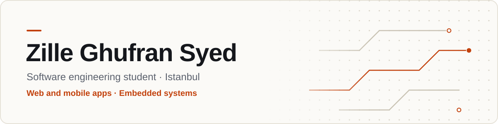

<picture>
  <source media="(prefers-color-scheme: dark)" srcset="assets/banner-dark.svg">
  
</picture>

I'm a senior software engineering student at **Istanbul Atlas University**. I build full-stack web and
mobile apps, and I like going down to the hardware too: I've written flight-control code for a drone I
built myself. Right now I'm building **Realm**, and I'm **open to software engineering internships**
in Istanbul.

## Projects

<table>
  <tr>
    <td colspan="2">
      <h3><a href="https://github.com/Nightmareidk/Realm">Realm</a></h3>
      A social app for friend groups and gamers. Group chat, voice rooms, communities and profiles
      in one place, so you need one app instead of four.
      <ul>
        <li>Accounts with age checks, email verification and safer defaults for under-18s</li>
        <li>Communities with rooms, roles, permissions and moderation tools</li>
        <li>Real-time chat, DMs, group chats of up to 25 people, and voice rooms</li>
        <li>A web app and an Android app on the same backend, with 130+ automated tests</li>
      </ul>
      TypeScript · Next.js · React · Expo / React Native · Node.js · Fastify · WebSockets · PostgreSQL · LiveKit
    </td>
  </tr>
  <tr>
    <td width="50%" valign="top">
      <h3><a href="https://www.varlikent.com">Varlı Kent</a></h3>
      Website and admin platform for an Istanbul real estate and construction company, built during my
      internship. Six languages with right-to-left support, an AI assistant that searches listings by
      meaning, and an admin dashboard with roles and an activity log.
        
      React · Node.js · Express · MongoDB
       
      <a href="https://www.varlikent.com">varlikent.com</a> · <a href="https://github.com/Nightmareidk/Varlikent">code</a>
    </td>
    <td width="50%" valign="top">
      <h3><a href="https://github.com/Nightmareidk/smart-home-security">Smart Home Security</a></h3>
      A five-person university project: AI and IoT security for a model house. Camera AI spots
      intruders and fire, the door opens by fingerprint, face or password, and a voice assistant
      called Jarvis runs the house.
        
      Python · TypeScript · ESP32 · MQTT · Computer vision
    </td>
  </tr>
  <tr>
    <td width="50%" valign="top">
      <h3>Custom-built drone</h3>
      I designed, assembled and programmed my own drone. The flight-control code handles motor
      control and stable flight, and I tuned it until it flew reliably.
        
      C / C++ · Arduino · ESP32
    </td>
    <td width="50%" valign="top">
      <h3><a href="https://github.com/Nightmareidk/Tradingjs">Tradingjs</a></h3>
      A trading card marketplace. Browse cards, build a collection, and buy through a cart and
      checkout with user accounts and sessions.
        
      Node.js · Express · EJS
    </td>
  </tr>
</table>

## Experience

**Software Developer Intern** · Varlı Kent · Istanbul · Jun – Sep 2026 
Built the company's website and admin platform: six languages, an AI listing assistant, lead
handling, and speed and SEO work.

**Computer Science Instructor** · Freelance · 2021 – 2022 
Taught programming and computer science basics one-on-one and in small groups.

**English Teacher** · English Time · 2024 – 2026

## Tools I use

<picture>
  <source media="(prefers-color-scheme: dark)" srcset="https://skillicons.dev/icons?i=ts%2Cjs%2Creact%2Cnextjs%2Cnodejs%2Cexpress%2Cmongodb%2Cpostgres%2Cpy%2Cc%2Ccpp%2Carduino%2Ctailwind%2Cthreejs%2Cvite%2Cgit&theme=dark&perline=8">
  
</picture>

Also: React Native and Expo, ESP32, Fastify, WebSockets, MQTT.
